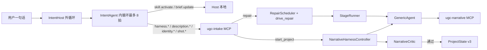

# UGC Video Harness：Agent 开发项目总结

> 基于当前代码整理（2026-09-04），包版本 `ugc-video-harness 0.8.1`。  
> 根目录 `README.md`、`docs/ugc设计.md` 里仍有一批 v2 / 旧图节点说法，**以本文件和源码为准**。

本文给要在本仓库里开发、改、扩 Agent 的人用：先建立正确心智模型，再指向该读的文件。

---

## 1. 这是什么

一套 **1–2 分钟竖屏 UGC 视频** 的多 Agent 生产系统。用户用口语说「做什么片子」，系统收齐任务书、规划内容、再按片种走不同下游，产出 `1080×1920` 成片。

核心不再是「固定 Stage Pipeline」，而是：

```text
ProjectState
+ TaskEnvelope（权限 / 预算 / 白名单）
+ GenericAgent（统一工具循环）
+ 领域能力（MCP 或进程内工具）
+ 独立 Critic
+ DependencyGraph
+ Controller Commit
= Harness
```

三条硬规则：

1. **Agent 只提议**，不直接改账本。提交候选 → Critic → Controller 才 `commit`。
2. **感知层不是制作层**。Intent Agent 只收 brief、读图、派单；不改正文，不调 `narrative.*`。
3. **片种差异是数据，不是再开一套 Agent**。同一批领域 Agent + Format Pack + 产线分流。

---

## 2. 仓库地图

```text
src/ugc_harness/
├── intake/                 # 感知层：对话、skill、图读写、派 start/repair
├── mcp_servers/
│   ├── intake.py           # 意图 MCP（stdio，进程名 ugc-intake）
│   └── narrative.py        # 叙事 MCP（stdio，进程名 ugc-narrative）
├── agents/
│   ├── generic.py          # 所有制作 Agent 共用的工具循环
│   ├── narrative_agent/    # 内容规划（三种片种）
│   ├── voice_agent/        # 口播 TTS + 字级对齐（仅 explainer）
│   ├── editorial_agent/    # Claim + 视觉需求（仅 explainer）
│   ├── asset_agent/        # 素材获取 / 修图（仅 explainer）
│   ├── timeline_agent/     # 音频主时钟剪辑（仅 explainer）
│   ├── render_agent/       # Remotion 渲染
│   └── instructions/       # 注入 TaskEnvelope 的说明书
├── harness/                # 状态、任务、图、Controller、Repair、产线
├── evaluators/             # 独立 Critic，不参与生成
├── content.py              # 内容平面模型（beat/scene/step/shot…）
├── profiles/               # a_roll / b_roll / ab_roll
├── tools/                  # 工具注册表、MCP transport
└── shared/                 # LLM / TTS / 产物写入 / 环境变量

app/backend/                # Studio：FastAPI + StageRunner
app/frontend/               # 审核 / 对话 / 图 / 时间线 UI
renderer/                   # Remotion（Node）
tests/                      # 契约测试；live 需 UGC_LIVE=1
docs/                       # 流程图与本总结
```

Python ≥ 3.11。入口见 `pyproject.toml` 的 `[project.scripts]`。

---

## 3. 两层 Agent，不要混



| | 感知层（Intake） | 制作层（Harness） |
|---|---|---|
| 对谁说话 | 用户 | 任务契约 / Critic |
| 循环 | `IntentHost` + `IntentAgent` | `GenericAgent` + `*HarnessController` |
| 决策 | `tool / arguments / message / done` | 选白名单工具直到 `*.submit_candidate` |
| MCP | `ugc-intake` | `ugc-narrative`（以及进程内 registry） |
| 禁止 | 改正文、调 `narrative.*`、自己算下游 | 自己 commit 账本、绕过 Critic |

---

## 4. 统一执行内核：`GenericAgent`

文件：`src/ugc_harness/agents/generic.py`。

阶段差异是 **TaskEnvelope 里的数据**，循环本身不变：

```text
budget gate
  → 模型 choose_tool（一次一个）
  → allowed_tools 白名单
  → ToolTransport 执行
  → 记 ActionRecord
  → ExecutionBoard 回灌 messages
  → 直到 *.submit_candidate 成功
```

- **stdio MCP**：`McpToolTransport` 拉起子进程（Narrative / Intake）。
- **进程内**：`RegistryToolTransport`（Voice / Editorial / Asset / Timeline / Render 多数还走这条）。
- `configure_task` / `configure_session` 由 transport 自动调，**不进** Agent 可见工具表。
- Critic 和 commit **在 Controller 里**，不在 loop 内。
- 提交被拒是工具错误，loop 继续，直到预算耗尽。

Controller 统一骨架：

1. `create_task()` → `TaskEnvelope` + `dependency_snapshot`
2. `GenericAgent.run()`
3. 独立 Critic
4. 更新 `evaluation.stages`、可选 `apply_*_realization`
5. `DependencyGraph.commit_batch()` 或 `reject_update()`
6. `record_task()` 写入 `trajectory`

后继链在 `harness/transitions.py`：

```text
narrative → voice → editorial → asset → timeline → render → project_complete
```

Repair 任务用 `approved_target="repair_scheduler"` 盖掉默认后继。Drama / Tutorial 的 Narrative 通过后会把 `approved_target` 指到 asset 阶段（实际由 `StageRunner` 分流到 Shot Stage）。

---

## 5. ProjectState v3

权威类型：`src/ugc_harness/harness/models.py` 的 `ProjectState`。  
落盘：`{project_dir}/harness/project_state.json`，`schema_version = "project-state.v3"`。

旧 v2 的 `video` / `runtime_context` / `description` / `execution` 读入时会迁到 v3。`visual_language`、`sound_design`、`world.state` 已丢弃。

| 顶层块 | 类型 | 写什么 |
|---|---|---|
| `context` | `ProjectContext` | `project_id`、`state_version`、可用模型/工具、约束 |
| `creative` | `CreativeState` | 已承诺的 `brief` + 解析后的 `intent` |
| `production` | `ProductionState` | **改字写这里**：world / structure / voice / shots / timeline / deliverable |
| `evaluation` | `EvaluationState` | 同 ref 的执行标签 + 七阶段门控 |
| `dependency_graph` | `DependencyGraphState` | 已提交内容节点与边 |
| `trajectory` | `TrajectoryState` | 按 phase 追加的任务历史 |

### 5.1 production

即 `VideoDescription` 的持久化切片（`harness/description.py`）：

- `world`：`cast` / `props` / `places` / `claims`
- `structure`：三种之一  
  - explainer：`sections`（hook/body/close）+ `beats`  
  - drama：`scenes` + `actions`  
  - tutorial：`steps` + `actions` + materials
- `voice`：utterances（可带 `audio_segment`）、旁白文件、对齐
- `shots`：`ShotDescription(spec, continuity, media?)`
- `timeline` / `deliverable`

**Beat 是什么**：讲解片里的一段剧情单位（`PlannedBeat`），图上 `beat:{planned_beat_id}`。短剧同层叫 `scene`，教程同层叫 `step`。`section` / `action` / `clip` 只在文档里，**不进图**。

### 5.2 evaluation.stages

`narrative / script / voice / editorial / asset / timeline / render`  
取值包括 `pending | ready | running | passed | failed | stale | blocked | locked | needs_revision | not_required`。

Drama / Tutorial 的 `voice`、`editorial` 会标 `not_required`。

`AgentResult.state_patch` 仍可能写旧路径 `video.*_status`，Controller 会过滤；**权威字段是 `evaluation.stages`**。

### 5.3 TaskEnvelope

制作 Agent 看见的任务契约：

- `scope`：`project_id` + 各类 id 列表 + **`target_refs`**（repair 授权范围）
- `allowed_tools` / `required_outputs` / `forbidden_actions`
- `budget`：`max_steps`（默认 4，explainer 开工 8，drama/tutorial 10，shot repair 3）
- `based_on_state_version`、`input_hash`、`dependency_snapshot`
- `create_shot`：新建镜头时锁定拓扑

---

## 6. 三种片种，两条产线

分流函数：`harness/production_routes.py` 的 `resolve_production_route`。  
看的是 **已提交的 `ProductionShot.shot_kind`**，不是口头 brief。一支片子不能混片种。

| 片种 | Narrative 工具链 | 下游 | 画面 / 声音 |
|---|---|---|---|
| **explainer** 讲解 | `plan_sections → expand_beats → write_script → compile_shots` | voice → editorial → asset → timeline → render | 口播主时钟；`external_narration` |
| **drama** 短剧 | `design_world → plan_story → expand_scenes → compile_shots` | shot asset → shot timeline → shot render | `generated_scene` + 片内音轨 |
| **tutorial** 教程 | `define_result → plan_steps → plan_explanations → compile_shots` | 同上 shot 三阶段 | `procedure_demo` + 操作原声/混合 |

`production_mode=auto` 默认按 explainer 开工。

公共生产单位是 **`ProductionShot`**（`content.py`）。上游语义（beat / scene / step）不同，编译后收敛到 shot，再往下实现媒体。

Format Pack：`harness/narrative_formats.py`。加新片种主要是加一个 Pack + MCP 工具 + Critic + `description_builder`。

---

## 7. 领域 Agent 与 Critic

### 7.1 Narrative

- Controller：`harness/controller.py` `NarrativeHarnessController`
- 输入：`CreativeBrief`；输出：`NarrativeArtifact`
- Transport：stdio `ugc-narrative`
- 开工后 `build_video_description` → `apply_narrative_document` → `content_commits` 写入图
- Shot 编译在 `agents/narrative_agent/shots.py`（确定性）
- 质检：`evaluators/narrative_critic.py`（explainer / drama / tutorial 分叉）

### 7.2 Explainer 下游（LLM 选工具 + 确定性能力）

| Agent | Controller | 白名单工具 | 业务是否 LLM |
|---|---|---|---|
| Voice | `voice_controller.py` | `voice.create_plan`、`audio.synthesize_narration`、`voice.submit_candidate` | 选工具是；TTS/对齐确定性 |
| Editorial | `editorial_controller.py` | `editorial.create_plan`、`editorial.submit_candidate` | 规划是 LLM |
| Asset | `asset_controller.py` | `asset.acquire_requirement`、`asset.prepare_image`、`asset.submit_candidate` | 选工具是；获取 first-success |
| Timeline | `timeline_controller.py` | `timeline.compose`、`timeline.submit_candidate` | 选工具是；合成确定性 |
| Render | `render_controller.py` | `render.execute`、`render.submit_candidate` | 选工具是；Remotion 确定性 |

Editorial 最多 3 轮 revision，可 `use_best_available`。Asset 对可修图片会自动再派 `prepare_image`。

### 7.3 Drama / Tutorial 下游（确定性 Stage，不是 Agent）

| Stage | Controller | `agent` 字段 | 做什么 |
|---|---|---|---|
| Shot Asset | `shot_asset_controller.py` | `asset_stage` | 逐镜 Seedance 出 AI 视频 |
| Shot Timeline | `shot_timeline_controller.py` | `timeline_stage` | 按叙事顺序拼接，保留原生音 |
| Shot Render | `shot_render_controller.py` | `render_stage` | Remotion，`source_voice=null` |

产物文件是 `shot_asset_artifact.json` / `shot_timeline_artifact.json`，不是 explainer 那套 `asset_artifact.json`。

当前 **Shot timeline / render 还不支持走 Repair task**（`stage_runner.py` 会直接 raise）。

### 7.4 Critic 验收什么

| Critic | 文件 | 过线条件（摘要） |
|---|---|---|
| Narrative | `evaluators/narrative_critic.py` | 结构覆盖、片种视觉契约、profile 匹配 |
| Voice | `voice_critic.py` | WAV 存在、segment/beat 覆盖、说话人一致 |
| Editorial | `editorial_critic.py` | 每 RealizedBeat 一条视觉需求、A-roll 连续 |
| Asset | `asset_critic.py` | 覆盖、文件在、身份一致、1080×1920 修图 |
| Timeline | `timeline_critic.py` | beat 顺序、无 gap、字幕覆盖 |
| Render | `render_critic.py` | 1080×1920@30、H.264/AAC、时长误差 ≤1 帧 |

Critic 失败出 `CriticIssue`（含 `repair_options`），不写文件。

---

## 8. 依赖图

实现：`harness/dependencies.py` + `dependency_builders.py`。  
感知层精简视图：`intake/graph_view.py`。

### 8.1 进图的 7 种节点

| kind | ref | 谁生产 | 读图 |
|---|---|---|---|
| `cast` / `prop` / `place` | `cast:` / `prop:` / `place:` | narrative | 无参 `list_graph` 的内容根 |
| `beat` \| `scene` \| `step` | 一支片子只用一种 | narrative | 同上 |
| `utterance` | `utterance:` | narrative | `around_ref` 才见 |
| `audio` | `audio:` | voice（或 narrative 若已有 audio_segment） | 同上 |
| `shot` | `shot:` | narrative | 同上 |

**不进图**：`section` / `action` / `clip`。  
**editorial / asset / timeline / render 的 `*_commits` 目前返回空列表**——下游依赖主要靠阶段门控和产物文件，不是图上的 `artifact:timeline`。

别名（`graph_view.candidate_graph_refs`）：`planned_beat`/`realized_beat` → `beat`；`script_segment` → `utterance`；`character` → `cast` 等。

节点字段：`status`（`current|stale`）、`locked`、`produced_by`、`depends_on` / `dependents`、`edges[]`、hash / version。

### 8.2 三种边 `EdgeFamily`

```python
EdgeFamily = Literal["plot", "identity", "element"]
```

旧值 `"voice"` 读入时强制改成 `"element"`。

| family | 从哪到哪（`to` = 上游） |
|---|---|
| **plot** | beat → 前一段（仅 explainer，且 relation ∈ callback / evidence_for / example_of / resolution）；utterance → `anchor_ref`；shot → `source_refs` |
| **identity** | shot → `binds`（cast/prop/place） |
| **element** | audio → utterance；可选 speaker |

箭头指向上游。`invalidate` **不看 family**，沿 `dependents` BFS 标 `stale`。locked 节点会让整团失败。

`list_graph`：无参只返回内容根；`around_ref` 返回中心 + 一跳。不要把全图塞进对话。

---

## 9. 修改：定点 → 弄脏 → 循环修

感知层只交 `target_refs[]` + `instruction`，不选手、不加 dependents。

```text
解析别名
  → invalidate_subgraph（种子 + dependents → stale）
  → RepairScheduler.plan（stale 祖先 + 可跑前沿，按 produced_by 组 Task）
  → drive_repair（最多 12 轮）
  → StageRunner.run(task, feedback=instruction)
```

入口：

- Intake：`intake/actions.py` `repair_description` → `harness/stage_execution.py` `run_repair_task`
- Studio：`app/backend/repair_service.py`

Narrative 局部修走 `harness/shot_repair.py`：只开 `repair.submit_candidate`，按 shot patch 改 `production.shots`，**无 Critic**，直接 commit 允许范围内的节点。Scope 外 hash 变化 → `REPAIR_SCOPE_VIOLATION`。

图编辑（`harness/graph_edit.py` + `intake/graph_ops.py` / `identity.py`）：

- `identity.update`：改已有身份字段，id 不变
- `identity.create`：新增身份根
- `shot.bind`：给现有镜追加 binds（只加不换）
- `shot.create`：声明锚点后派 generic 写新镜
- `graph.remove`：删无 dependents 的身份或镜头

改完身份/绑定后仍要 `harness.repair`，Harness 自己展开脏子图。

---

## 10. 感知层：对话怎么变成开工 / 改片

### 10.1 循环

- 外循环：`intake/host.py` `IntentHost.respond`  
  记对白 → 正则抽 brief → 有项目则刷新 progress → 内循环 → 落盘 Session
- 内循环：`intake/agent.py` `IntentAgent`，默认 **最多 8 拍**
- 说明书：`intake/agent.md`（注入 system）
- 决策四字段：`tool`、`arguments`、`message`、`done`  
  对用户说话时 `tool` 必须 null；调工具时 `message` 必须空

Session：`intake-session.v2`，CLI 在 `{output_root}/.intake/`，Web 在 `app/data/intake/`。

`working_brief` 两刀写：

1. Host 正则：本句字面上的 topic / 时长 / 平台等
2. Agent `brief.update`：点头、选择题、改口、观众（正则不管观众）

开工硬条件（缺一条禁止 `start_project`）：topic、goal、audience.description、platform、duration_target_ms。先用人话复述，用户点头才能开工。

### 10.2 Skills（先 activate 再办事）

`intake/skills/*.md`，`skill.activate` 只把正文读进对话。

| name | 何时 |
|---|---|
| `clarify-brief` | 收字段、缺口多于 1 |
| `start-project` | 调 `harness.start_project` 之前（硬性） |
| `inspect-graph` | 改已产出内容、未点名段落 |
| `revise-segment` | 用户点了「第几段」 |
| `user-revises` | 改口改的是诉求，不是正文 |
| `inspect-progress` | 问进度 |

记账用 `brief.update`，不必先 activate。

### 10.3 意图工具

**Host 本地**（不经 MCP 子进程）：`skill.activate`、`brief.update`。

**MCP（`ugc-intake`）**：

| 工具 | 作用 |
|---|---|
| `description.list_outline` | 大纲 id + 标题 |
| `description.get_element` | 单个元素全文 |
| `identity.update` / `identity.create` | 改 / 新建身份 |
| `shot.create` / `shot.bind` | 新镜 / 追加绑定 |
| `graph.remove` | 删节点 |
| `harness.list_graph` | 精简图 |
| `harness.start_project` | 从 session.working_brief 物化 brief，跑 Narrative |
| `harness.inspect` | 刷新 progress |
| `harness.repair` | 定点修复 |

意图 MCP **不写** `working_brief`，**不暴露** `narrative.*`。

---

## 11. Studio App

`app/backend/main.py`，默认 `127.0.0.1:8000`，标题 UGC Beat Studio。

接线：

```text
IntakeService  → IntentHost / Intake MCP / StageRunner.start_from_brief
StageRunner    → 各 *HarnessController（唯一执行桥）
ProjectService → 读 project_state + 产物文件，算 current_stage
RepairService  → invalidate + drive_repair
ReviewService  → 用户批准阶段
*Projector     → beat / graph / timeline / task 给前端
```

阶段名始终是 `narrative → voice → editorial → asset → timeline → render`。Drama / Tutorial 在 asset 起换 Shot Controller，前端阶段名不变。

---

## 12. CLI、配置、产物

### 12.1 命令

| 命令 | 入口 | 用途 |
|---|---|---|
| `ugc-intake` | `intake.cli` | 对话收 brief / 开工 / 改片 |
| `ugc-harness` | `narrative_agent.cli` | 从 topic 直接跑 Narrative |
| `ugc-voice` / `ugc-visual-plan` / `ugc-assets` / `ugc-timeline` / `ugc-render` | 各 agent CLI | 对已有项目跑下一阶段 |

### 12.2 环境变量（`.env`，只解析 `KEY=value`）

| 变量 | 用途 |
|---|---|
| `VOLCENGINE_ARK_API_KEY` / `VOLCENGINE_ARK_BASE_URL` | OpenAI 兼容 Chat |
| `UGC_LLM_MODEL` | 默认 `doubao-seed-2-0-lite-260215` |
| `UGC_IMAGE_MODEL` | 默认 `doubao-seedream-5-0-260128` |
| `UGC_VIDEO_MODEL` | 默认 `doubao-seedance-2-0-260128` |
| `VOLCENGINE_TTS_*` | 口播 TTS |
| `UGC_LIVE=1` | 打开 live pytest |

渲染还要本机 `renderer/node_modules`、Edge、ffmpeg。

### 12.3 项目目录

```text
outputs/<项目名>/
├── manifest.json
├── harness/project_state.json          # 账本
├── harness/*_task.json / *_evaluation.json / *_transition.json
├── narrative_artifact.json             # 以及 01_… 分件
├── voice_artifact.json / editorial_… / asset_… / timeline_… / render_…
├── shot_asset_artifact.json            # drama/tutorial
├── audio/  assets/  video/final.mp4
```

---

## 13. 测试

```powershell
.\.venv\Scripts\python.exe -m pytest
```

- **契约**（默认）：Fake LLM、`QueueToolModel`、fixture MCP、纯函数。不打外部 API。
- **Live**：`UGC_LIVE=1` + key，跑 `tests/test_intake_live.py`、`tests/test_narrative_live.py`。
- App：`app/tests/`（intake / repair / views）。

加 Agent 时至少补：Controller 假模型测试、Critic 纯函数、图 commit / invalidate。

---

## 14. 扩展点（按你要改的东西）

### 新领域 Agent（例如 music）

1. `agents/music_agent/models.py`（Artifact + Candidate）
2. 能力：MCP server 或 registry 工具
3. `harness/music_controller.py`（create_task + GenericAgent + critic + commit）
4. `evaluators/music_critic.py`
5. `dependency_builders.py` 的 commits（若要进图）
6. `shared/artifacts.py` 写入
7. `production_routes.py`、`stage_runner.py`、`project_service.STAGES`
8. CLI + `pyproject.toml` scripts
9. App：`schemas.StageName`、projector、路由
10. `agents/instructions/music.md`

### 新 Narrative 片种

`content.py` 结构/shot payload → `narrative_agent/models.py` + `prompts.py` → `narrative_formats.py` Pack → `mcp_servers/narrative.py` 工具 → critic → `description_builder.py` / `dependency_builders.py`。

### 新 Intake Skill

`intake/skills/my-skill.md`（frontmatter：`name`、`description`）。需要新手：`intake/tools.py` + `mcp_servers/intake.py` + `actions.py`。

### 新图节点 kind

`CONTENT_PREFIXES` + `content_commits` → `description.py` 寻址 → `graph_view.py` 别名 → `graph_edit.py` / `repair.py` → App `graph_projector.py`。

---

## 15. 建议阅读顺序

1. 本文件 + `docs/intent-agent-loop.drawio` + `docs/video-repair-and-project-state.drawio`
2. `agents/generic.py` 文件头（循环契约）
3. `harness/models.py`（State / Task / Edge）
4. `harness/controller.py`（完整的一次 commit）
5. `harness/production_routes.py` + `narrative_formats.py`
6. `intake/agent.md` + `intake/host.py` + `intake/agent.py`
7. `harness/repair.py` + `shot_repair.py`
8. `app/backend/stage_runner.py`（Studio 如何接到 Controller）

不要从 `README.md` 的依赖图章节开始——那里的 `artifact:narrative`、Beat 级旧节点名已经不是当前实现。

---

## 16. 过时说法对照

| 旧文档还在写 | 当前代码 |
|---|---|
| 图上只有 `artifact:narrative` | `cast/prop/place/beat|scene|step/utterance/audio/shot` |
| `planned_beat → script_segment → realized_beat → visual_requirement → clip` | 这些 **不是** 图节点 |
| 边 family = `voice` | 现为 `element`（读旧数据会coerce） |
| Drama/Tutorial「交给 Asset Agent」 | 实际是 `ShotAssetHarnessController` |
| Agent `state_patch` 驱动 `video.*_status` | 权威是 `evaluation.stages` |
| 扁平 `description` + `execution` | `production` + `evaluation` |
| Repair 走完整 narrative MCP 链 | 局部修只开 `repair.submit_candidate` |

`RepairScheduler` 这个类名 **还在**（`harness/repair.py`），不是过时名字。

---

## 17. 关键文件索引

| 主题 | 路径 |
|---|---|
| 状态 / 任务 / 边 | `src/ugc_harness/harness/models.py` |
| 内容文档 | `src/ugc_harness/harness/description.py` |
| Artifact → 文档 | `src/ugc_harness/harness/description_builder.py` |
| 图构建 / 图服务 | `dependency_builders.py` / `dependencies.py` |
| 图编辑 | `harness/graph_edit.py` |
| Repair | `harness/repair.py`、`shot_repair.py` |
| 产线 | `production_routes.py`、`narrative_formats.py` |
| 统一 Agent | `src/ugc_harness/agents/generic.py` |
| 意图说明书 | `src/ugc_harness/intake/agent.md` |
| 意图 MCP | `src/ugc_harness/mcp_servers/intake.py` |
| 叙事 MCP | `src/ugc_harness/mcp_servers/narrative.py` |
| Studio 执行桥 | `app/backend/stage_runner.py` |
| 内容模型 | `src/ugc_harness/content.py` |

**一句话**：感知层定点，Harness 弄脏子图再拉制作 Agent；账本拆成 context / creative / production / evaluation / graph / trajectory；讲解走六 Agent 链，短剧/教程在 asset 起换成确定性 Shot Stage。
